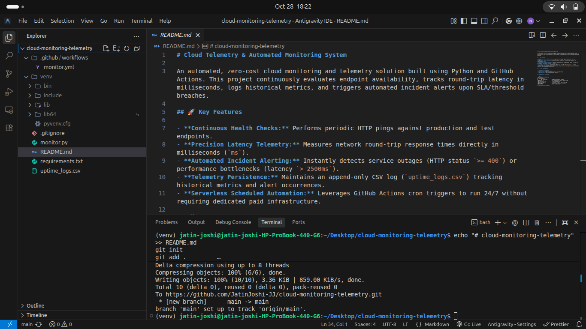
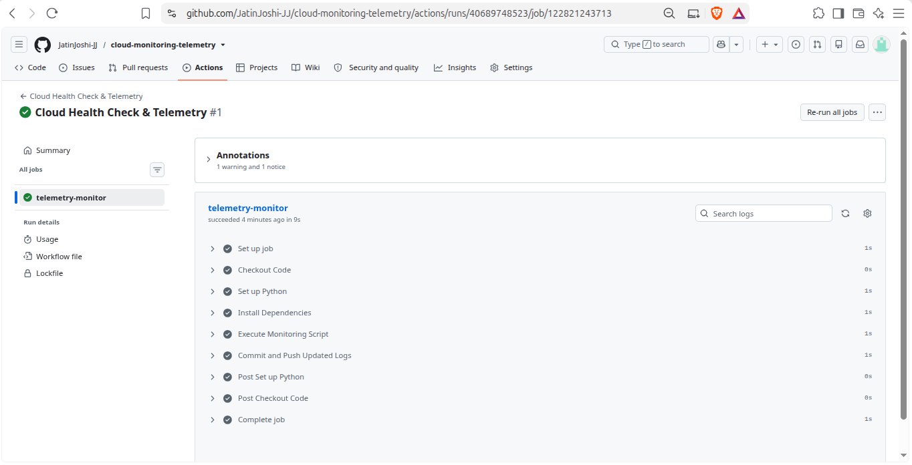
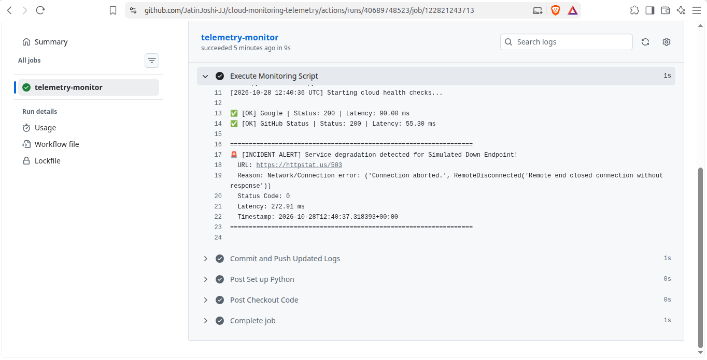
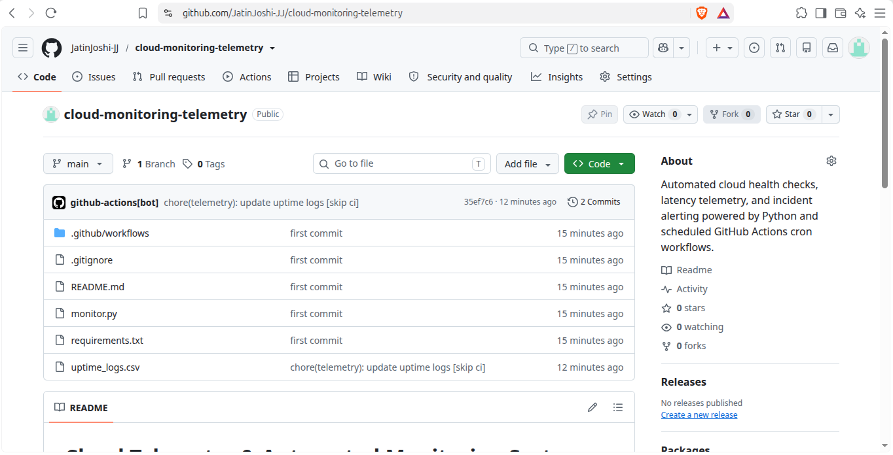

# Cloud Telemetry & Automated Monitoring System

An automated, zero-cost cloud monitoring and telemetry solution built using Python and GitHub Actions. This project continuously evaluates endpoint availability, tracks round-trip latency in milliseconds, logs historical metrics, and triggers automated incident alerts upon SLA/threshold breaches.

## 🚀 Key Features

- **Continuous Health Checks:** Performs periodic HTTP pings against production and test endpoints.
- **Precision Latency Telemetry:** Measures network round-trip response times directly in milliseconds (`ms`).
- **Automated Incident Alerting:** Instantly detects service outages (HTTP status `>= 400`) or performance bottlenecks (latency `> 2500ms`).
- **Telemetry Persistence:** Maintains an append-only CSV log (`uptime_logs.csv`) tracking historical metrics and alert occurrences.
- **Serverless Scheduled Automation:** Leverages GitHub Actions cron triggers to run 24/7 without requiring dedicated paid infrastructure.

## 🛠️ Tech Stack & Tools

- **Language:** Python 3.12
- **Networking:** Requests library
- **Automation / Scheduler:** GitHub Actions (Cron Workflow)
- **Data Format:** CSV (Comma-Separated Values)

## 📁 Repository Structure

```text
cloud-monitoring-telemetry/
├── .github/
│   └── workflows/
│       └── monitor.yml        # Scheduled automation workflow
├── monitor.py                 # Core telemetry and health check script
├── requirements.txt           # Project dependencies
├── uptime_logs.csv            # Structured telemetry and uptime log
├── .gitignore                 # Excludes venv and build artifacts
└── README.md                  # System documentation
```

# cloud-monitoring-telemetry

## 📸 Execution & Verification Proofs

### 1. Local Health Check & Incident Trigger



### 2. Scheduled GitHub Actions Workflow Run



### 3. Detailed Telemetry Logs & Incident Alert



### 4. Automated Telemetry Log Commit via Bot


